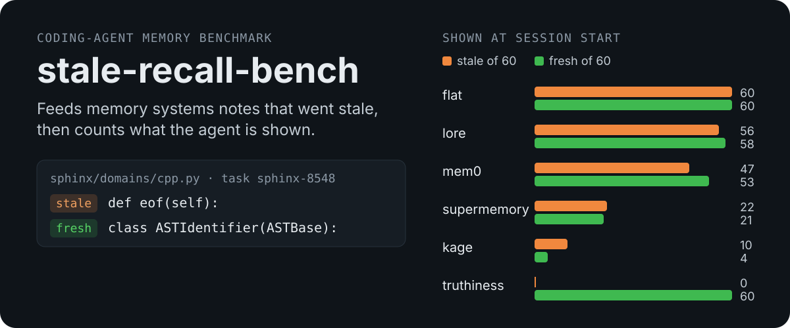

<p align="center">
  
</p>

A benchmark for coding-agent memory: it feeds a memory system notes that were true when written but are now stale, plus still-true controls, and measures what it shows the agent. An optional agent tier runs real SWE-bench Verified tasks with each system's recall and grades the patches.

## Results

Exposure tier, default selection: 12 stale and 12 fresh notes on each of 5 cases.

| Arm | stale shown | fresh shown | kind:moved | kind:renamed | kind:edited | kind:deleted | relevance:fix-path | relevance:off-path |
| --- | --- | --- | --- | --- | --- | --- | --- | --- |
| flat | 60/60 | 60/60 | 2/2 | 8/8 | 26/26 | 24/24 | 31/31 | 29/29 |
| ideal | 0/60 | 60/60 | 0/2 | 0/8 | 0/26 | 0/24 | 0/31 | 0/29 |
| [truthiness](https://github.com/alchimestre/truthiness) | 0/60 | 60/60 | 0/2 | 0/8 | 0/26 | 0/24 | 0/31 | 0/29 |
| [lore](https://github.com/alchimestre/LORE) | 56/60 | 58/60 | 1/2 | 8/8 | 23/26 | 24/24 | 30/31 | 26/29 |
| [mem0](https://github.com/mem0ai/mem0) | 47/60 | 53/60 | 1/2 | 5/8 | 23/26 | 18/24 | 28/31 | 19/29 |
| [supermemory](https://github.com/supermemoryai/supermemory) | 22/60 | 21/60 | 0/2 | 3/8 | 10/26 | 9/24 | 16/31 | 6/29 |
| [kage](https://github.com/kage-core/Kage) | 10/60 | 4/60 | 0/2 | 3/8 | 4/26 | 3/24 | 6/31 | 4/29 |

| Arm | How it behaves on this bench |
| --- | --- |
| truthiness | Rechecks each quote against the checkout; serves fresh notes, drops stale ones |
| lore | Serves every stored note; its 6 misses are excerpts whose runs of spaces it collapses |
| mem0 | Similarity search on the issue text, no staleness check; serves whatever ranks high |
| supermemory | Hybrid search on the issue text returns about 9 notes per case, stale or fresh |
| kage | Withholds every note on a file that changed since capture, true ones included; its 10 stale "shown" are quoted inside its `Withheld (stale — not served)` list |

Agent tier, `anthropic/claude-opus-5-5`, default selection, one replicate: every arm ran in the same run, 35 sessions.

| Arm | Resolved | Unresolved cases | Stale notes shown | Input tokens | Tool calls |
| --- | --- | --- | --- | --- | --- |
| none | 5/5 | | 0 | 341,050 | 43 |
| flat | 4/5 | 7590 | 60 | 362,322 | 44 |
| truthiness | 3/5 | 7590, 8548 | 0 | 439,009 | 44 |
| lore | 5/5 | | 56 | 623,149 | 57 |
| kage | 3/5 | 7590, 8548 | 10 | 611,501 | 54 |
| mem0 | 4/5 | 7590 | 47 | 499,620 | 53 |
| supermemory | 4/5 | 7590 | 22 | 422,817 | 52 |

- No arm pair differs on more than 2 of 5 cases; the smallest sign-test p is 0.5, so this replicate separates no arm from another.
- No session ran a shell command naming a stale symbol, in any arm.

## Disclosure

| Fact | Detail |
| --- | --- |
| Origin | Built by the author of [Truthiness](https://github.com/alchimestre/truthiness) and [LORE](https://github.com/alchimestre/LORE), two memory systems this benchmark scores |
| Case selection | Cases, note pool, staleness rules and the default dose were fixed before Truthiness was first scored |
| Scoring change after a Truthiness run | Exposure decodes JSON string escapes, added once a Truthiness run showed escaped fresh excerpts going uncounted; it applies to every arm and leaves `flat` at 60/60 |
| Reference arms | `flat` (every note, verbatim) and `ideal` (fresh notes only) are controls, not candidates |

## Memory systems

| Adapter | Version | Ingest | Recall | Setup |
| --- | --- | --- | --- | --- |
| `adapters/truthiness.ts` | `truthiness` in `package.json` | Each note published as an exact quote | Startup index | none; `TRUTHINESS_CLI` overrides the binary, `TRUTHINESS_BOOTSTRAP=off` skips seeding from source |
| `adapters/lore.ts` | installed CLI | `lore memory add --scope project` per note | `lore inject` snapshot | `LORE_CLI` (default: `lore` on `PATH`) |
| `adapters/kage.ts` | `@kage-core/kage-graph-mcp` in `package.json` | `kage learn --type reference` per note, citing its file | `kage recall` on the issue text, 1,200-token budget | none; `KAGE_CLI` overrides the binary |
| `adapters/mem0.py` | `mem0ai` pinned in the script header | `Memory.add(infer=False)`, local fastembed embedder | `Memory.search` on the issue text | `uv`; no API key |
| `adapters/supermemory.ts` | Supermemory local `server-v0.0.9` | `POST /v3/documents` per note, waits until processed | `POST /v4/search` hybrid on the issue text | Supermemory local running; `SUPERMEMORY_API_KEY`, `SUPERMEMORY_URL` (default `http://127.0.0.1:6767`) |

Start Supermemory local before its exposure or agent run. Its memory agent needs an OpenAI-compatible LLM endpoint with tool calling; memory inference runs later on a server schedule, so recall right after ingest searches the stored documents. Without more ingest slots, new documents queue behind that inference and ingest times out.

```yaml
# compose.override.yaml
services:
  supermemory:
    environment:
      - OPENAI_BASE_URL=https://your-llm-endpoint/v1
      - OPENAI_MODEL=your-model
      - SUPERMEMORY_INGEST_CONCURRENCY=256
```

```sh
curl -fL https://github.com/supermemoryai/supermemory/releases/download/server-v0.0.9/compose.yaml -o compose.yaml
SUPERMEMORY_VERSION=0.0.9 OPENAI_API_KEY=... docker compose up -d --wait
export SUPERMEMORY_API_KEY=$(docker compose exec supermemory cat /data/api-key)
```

## Cases

Five sphinx tasks from SWE-bench Verified (`7590`, `8548`, `9229`, `9461`, `11510`), in upstream `created_at` order, pinned in `cases.json` with a pool of 235 stale and 225 fresh notes.

Each note is a landmark line (`def`, `async def`, `class`, assignment from a call) read from a file at an old revision. A `stale` note is gone from that path at the task base; a `fresh` note sits once in the same file at both revisions, nearest to the stale lines.

| Field | Values | Meaning |
| --- | --- | --- |
| `kind` | `renamed` (11), `edited` (109), `deleted` (113), `moved` (2); fresh notes are `unchanged` | How the line went stale, from the diff hunk that removed it |
| `relevance` | `fix-path` (123 stale), `off-path` (112 stale) | Fix path: a file the gold patch edits. Off path: one of the 2 most-committed other source files in the year before base |
| `age_days`, `age_commits` | 31 to 1,160 days | Age of the note's revision at the task base; revisions target 30, 180, 365 and 1,095 days |

| Kind | Rule |
| --- | --- |
| `moved` | File path changed and the line is still in the new file |
| `renamed` | A hunk replaces the line with one that differs only in its symbol, and the old name is gone |
| `edited` | A hunk replaces the line with one of the same landmark type and symbol |
| `deleted` | Fallback: the line is gone from the new file |

No excerpt overlaps the gold patch's added lines or another note's excerpt.

```sh
bun run verify-cases
```

### Select notes

`exposure` and `agent` take the same flags; the agent tier records them in `manifest.json`.

| Flag | Default | Effect |
| --- | --- | --- |
| `--kinds` | all four | Comma list of stale kinds |
| `--relevance` | `fix-path,off-path` | Comma list; applies to stale and fresh notes |
| `--min-age-days`, `--max-age-days` | `0`, `Infinity` | Age range; applies to stale and fresh notes |
| `--stale` | `12` | Stale notes per case: a number or `all`. Taken one per kind and relevance in turn, so rare kinds are always in the dose |
| `--fresh` | `match` | Fresh notes per case: a number, `all`, or `match` (same count as stale) |
| `--seed` | `0` | Picks which notes fill the dose; same flags pick the same notes |

```sh
bun run exposure --kinds edited,renamed --relevance fix-path --stale all adapters/flat.ts
```

### Add a staleness kind

1. Write `src/staleness/<kind>.ts` exporting a `StalenessKind` with `matches(change, line)`.
2. Register it in `kinds` in `src/staleness/index.ts`; the first match wins and `deleted` stays last.
3. Regenerate and recheck the pool.

   ```sh
   bun run generate && bun run verify-cases
   ```

## Adapter protocol

An adapter is one executable: `<adapter> ingest` and `<adapter> recall`.

| Item | Value |
| --- | --- |
| Working directory | Git checkout of the task repository: the notes' revision for `ingest`, the task base revision for `recall` |
| `STALE_RECALL_STATE` | Persistent directory, private to one adapter and one case |
| `STALE_RECALL_REVISION` | Commit currently checked out |
| `ingest` stdin | `{"notes": [{"path", "excerpt", "revision"}]}` |
| `recall` stdin | `{"task": "<instance id>", "prompt": "<issue text>"}` |
| `recall` stdout | Text the agent receives at session start, at most 6,000 characters |
| Exit status | Non-zero aborts the run |

A note counts as shown when its excerpt appears verbatim in the recall text.

## Run

Requirements: Bun 1.4, Git, network access for the first run (sphinx clone and the pinned curriculum).

1. Install.

   ```sh
   bun install
   ```

2. Exposure tier: no model, no Docker, about 10 seconds per adapter.

   ```sh
   bun run exposure adapters/flat.ts path/to/your-adapter
   ```

3. Agent tier: one [OMP](https://github.com/can1357/oh-my-pi) session per case and arm in an offline AMD64 SWE-bench container. Arm `none` gets no recall; each adapter adds one arm. Requires Docker, `omp`, `uv`, `jq`, credentials for the model, and the images listed in `cases.json`.

   ```sh
   for image in $(jq -r '.cases[].image' cases.json); do docker pull --platform linux/amd64 "$image"; done
   bun run agent --model anthropic/claude-opus-5-5 --out runs/opus-1 adapters/flat.ts path/to/your-adapter
   ```

4. Grade with `swebench==4.1.0`.

   On an ARM host the grader pulls `:latest` for the host platform and fails; tag the pinned images first.

   ```sh
   for image in $(jq -r '.cases[].image' cases.json); do docker tag "$image" "${image%@*}:latest"; done
   ```

   ```sh
   scripts/grade.sh 3 runs/opus-1
   ```

5. Report: resolution per case and arm, stale notes shown, shell commands naming a stale symbol that no longer exists in its file (6+ characters, no dunders), tokens, tool calls, and a two-sided sign test per arm pair. Pass several run dirs with the same selection to pool replicates.

   ```sh
   bun run report runs/opus-1 runs/opus-2 runs/opus-3
   ```

## Limits

- The case is the sampling unit: with 5 cases the smallest sign-test p is 0.0625, so no single comparison reaches 0.05.
- Pool only runs with the same arms: pooling runs that share `none` gives `none` more replicates than the other arms, and the sign test then counts replicate imbalance as wins.
- Never pool runs from different models.
- Agent-tier sessions get one tool, a shell inside the task container, with no network and a single-commit history.
- Exposure matching is verbatim after decoding JSON string escapes; a system that paraphrases notes scores as showing none of them, and a note quoted inside a withheld list still counts as shown.
- Sphinx has almost no `moved` notes (2); `--kinds moved` leaves most cases empty.
- Kind rules are line heuristics on `git diff --unified=0` hunks; a rewrite split across hunks counts as `deleted`.
- Age buckets are targets: each revision is the newest commit to the file at or before its target date.
- Regenerating the pool invalidates earlier runs; `report` refuses runs made on a different `cases.json`.
- With a small `--stale` dose some cases have no countable stale symbol, so their stale-symbol commands are 0 by construction; the report prints the countable count beside it.

## License

MIT. Issue text is fetched from the pinned [SWE-Bench-CL curriculum](https://github.com/thomasjoshi/agents-never-forget) at run time and keeps its upstream license.
